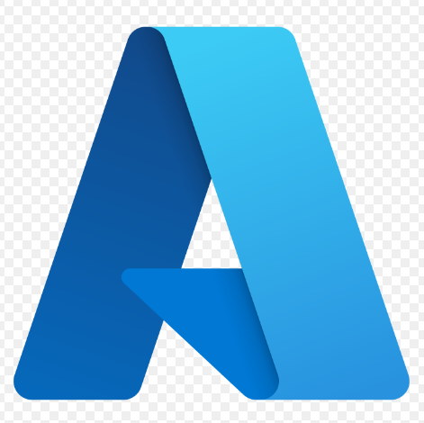
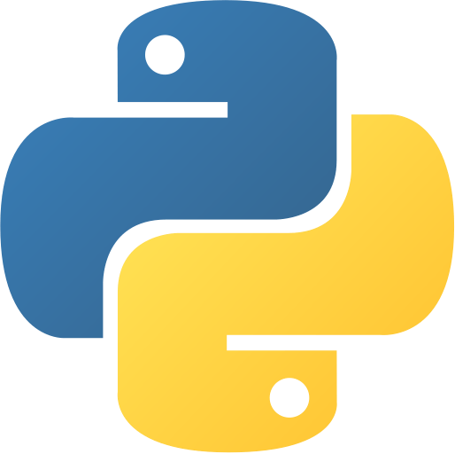

<!-- HEADER -->

  

<!-- STACK TECNOLÓGICO -->

  <h3>🧩 Stack Tecnológico</h3>
  
<i>Plataformas, lenguajes y frameworks</i>

 

<!-- DATA & PROCESSING -->

  <b>Procesamiento & Data</b>
    
  
  

  

<!-- CLOUD & LANGUAGES -->

  <b>Cloud & Lenguajes</b>
    
  
  
  
  

  

<!-- HERRAMIENTAS -->

  <b>Herramientas</b>
    
  
  
  
  

  

<!-- IDENTIDAD PROFESIONAL -->

  
    Data Engineering · Analytics · Distributed Systems · Cloud Architecture
  

  

<!-- LINKEDIN -->

  

  

